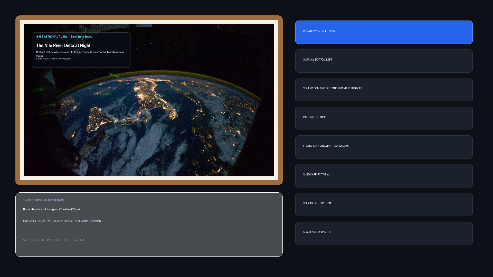

# 🌌 AstroFrame (Android TV & Google TV)

### The Ultimate Ambient Art & Deep-Space Screensaver for Android TV, Google TV & Fire TV
**Engineered with Apple tvOS Glassmorphism, 10-bit Deep Color, OLED Burn-In Care & Samsung "The Frame" Architectural Matting**

<p align="center">
  <a href="https://github.com/mandy321/AstroFrame/releases/latest"></a>
  <a href="https://github.com/mandy321/AstroFrame/releases"></a>
  <a href="https://github.com/mandy321/AstroFrame/releases/latest"></a>
  <a href="https://github.com/mandy321/AstroFrame/stargazers"></a>
  <a href="https://github.com/mandy321/AstroFrame"></a>
</p>

<p align="center">
  <a href="https://github.com/mandy321/AstroFrame/releases/latest/download/AstroFrame-v1.3.0.apk">
    
  </a>
  <a href="https://github.com/mandy321/AstroFrame/releases/latest">
    
  </a>
</p>

---

## ⚡ What Makes AstroFrame the GOAT?

While conventional video screensavers stream gigabytes of repetitive video loops, **AstroFrame** transforms your living room display into an authentic living gallery, combining living science, world fine art, and custom personal photo albums.

| Feature | AstroFrame | Conventional Screensavers (e.g. Aerial Views) |
| :--- | :---: | :---: |
| **Visual Library** | **5 Curated Living Collections** (NASA APOD, JWST, The Met, Rijksmuseum, Chicago, ISS & Custom) | Static catalog of ~200 aerial drone clips |
| **Personal Photos / Custom Art** | **Built-in Personal TV Album (`/Pictures/AstroFrame_Custom/`)** | Requires external NAS / WebDAV / Immich setup |
| **Bandwidth Consumption** | **Ultra-Low (<100MB/day)** with local 4K smart cache | Heavy (15–25 GB/day streaming 4K video) |
| **Hardware Color Depth** | **10-bit Wide Color Gamut (`RGBA_F16`)** — Zero sky banding | 8-bit standard |
| **Display Protection** | **Active OLED Care Engine** (Imperceptible micro-drift shifts) | Basic static overlay repositioning |
| **Samsung "The Frame" Mode** | **Architectural Beveled Matting** with 45° inner shadowbox | Border-to-border only (looks like a TV, not a canvas) |
| **Motion Engine** | **60 FPS Hardware "Ken Burns" Parallax** | Fixed video playback |
| **Music Ecosystem** | **AuraMusic "Now Playing" Island** synergy | Basic media session hook |
| **TV Remote Control** | **Full D-Pad Interactivity** (Skip, Pause, Metadata Inspector) | Variable support |

---

## 🎨 Supported Artwork Collections

AstroFrame lets you choose from 5 curated artwork streams or blend them together:

### 1. 🚀 NASA Cosmos & Webb (`NASA_COSMOS`)
* Deep-space nebulas, James Webb Space Telescope (JWST) infrared deep fields, and Hubble discoveries.
* Direct uncompressed 4K imagery from the official NASA Open Platform with full astronomical explanations.

### 2. 🎨 World Museum Masterpieces (`WORLD_MASTERPIECES`)
* World-renowned fine art and oil paintings from **The Metropolitan Museum of Art (New York)**, the **Rijksmuseum (Amsterdam)**, and the **Art Institute of Chicago**.
* Iconic masterworks by **Vincent van Gogh** (*Wheat Field with Cypresses*, *The Bedroom*), **Claude Monet** (*Water Lilies*), **Johannes Vermeer** (*The Milkmaid*), **Rembrandt** (*The Night Watch*), and **Katsushika Hokusai** (*The Great Wave*).

### 3. 🌍 Earth from Orbit & ISS (`EARTH_ORBIT`)
* Breathtaking 4K astronaut photography taken from the International Space Station cupola.
* Vibrant auroral ribbons (Aurora Australis), illuminated nighttime city grids (Paris, Cairo, Nile Delta), and atmospheric sunburst horizons.

### 4. 📁 Custom Personal Photos & Art (`CUSTOM_USER_FOLDER`)
* Showcase your own family photo albums, wedding memories, custom digital art, or favorite 4K wallpapers.
* Simply drop your `.jpg` or `.png` files into:
  ```text
  /sdcard/Pictures/AstroFrame_Custom/
  ```
* AstroFrame automatically detects and rotates your photos seamlessly in both screensaver and launcher modes.

### 5. 🌌 The Ultimate Canvas (`ULTIMATE_MIX`)
* An intelligent blend that alternates across space, museum paintings, orbital Earth photography, and your personal photo gallery.

---

## 📁 How to Add Your Own Photos & Wallpapers

AstroFrame gives you total freedom to display your personal photos with zero paid subscriptions or complex servers required:

```text
Target Directory on TV:
/sdcard/Pictures/AstroFrame_Custom/
```

### 4 Easy Ways to Beam Photos to your TV:
1. **Send Files to TV (SFTTV) [Recommended]**:
   - Install the free **"Send Files to TV"** app from the Google Play Store on your phone and TV.
   - Select your favorite photos on your phone and send them to the TV's `/sdcard/Pictures/AstroFrame_Custom/` folder.
2. **USB Flash Drive**:
   - Copy your 4K pictures to a thumb drive.
   - Plug it into your TV or NVIDIA Shield and use any free TV file manager (e.g. *X-plore* or *FX File Explorer*) to copy files into `/sdcard/Pictures/AstroFrame_Custom/`.
3. **Local Wi-Fi Network / SMB**:
   - If your TV is connected to your local network, transfer files over SMB or Windows Network Share directly from your PC or Mac.
4. **Direct ADB Transfer (over Wi-Fi)**:
   ```bash
   adb connect <TV_IP_ADDRESS>:5555
   adb push /path/to/my_photos/* /sdcard/Pictures/AstroFrame_Custom/
   ```

---

## 📸 Screenshots & Visual Preview

<div align="center">
  <table style="border: none; width: 100%;">
    <tr>
      <td width="50%" align="center">
        <b>🎨 The Met Museum & World Masterpieces</b><br>
        <a href="screenshots/preview_the_met.jpg"></a>
      </td>
      <td width="50%" align="center">
        <b>🚀 NASA Cosmos & Webb Deep Space</b><br>
        <a href="screenshots/preview_nasa_apod.jpg"></a>
      </td>
    </tr>
    <tr>
      <td colspan="2" align="center">
        <br><b>📺 Android TV Remote-Friendly D-Pad Interface</b><br>
        <a href="screenshots/preview_tv_app.png"></a>
      </td>
    </tr>
  </table>
</div>

---

## ✨ Flagship Capabilities

### 🎮 1. Interactive TV Remote D-Pad Navigation
* **`D-Pad Right / Media Next`**: Instantly crossfade to the next artwork.
* **`D-Pad Left / Media Previous`**: Return to the previous artwork.
* **`Center OK / Info Button`**: Toggle the Apple tvOS-style translucent metadata card (artwork title, telescope details, and dates).
* **`Play/Pause / D-Pad Down`**: Freeze rotation on any artwork to admire it indefinitely.
* **`Back / Escape`**: Instantly wake the television.

### 🛡️ 2. Active OLED Care & Anti-Burn-In Drift
* Designed specifically for **LG OLED**, **Sony Bravia QD-OLED**, and **Samsung OLED** displays.
* An imperceptible background shifter gently translates the artwork canvas and floating HUD by `[-3..+3]px` every 90 seconds. Subpixels never experience static retention.

### 🌈 3. 10-Bit Wide Color Gamut Deep Color Pipeline
* Eliminates color stepping, posterization, and gradient banding across deep space.
* Renders in **`Bitmap.Config.RGBA_F16`** (16-bit half-float depth) with `ActivityInfo.COLOR_MODE_WIDE_COLOR_GAMUT` on supported hardware.

### 🖼️ 4. Architectural Museum Matting (Samsung "The Frame" Mode)
* **Bezel-to-Bezel**: Edge-to-edge full screen photography.
* **Modern Slim Mat (24dp)**: Clean modern border.
* **Museum Classic Bevel (48dp)**: 45-degree architectural inner bevel shadow with archival warm gallery cream (`#F4EFE6`).
* **Gallery Deep Shadowbox (72dp)**: Premium framed exhibition look.

### 🎥 5. Cinematic 60 FPS "Ken Burns" Parallax
* Smooth, meditative slow pan and scale (`1.065x`) rendered at 60 FPS without stuttering or video compression artifacts.

### 🎶 6. AuraMusic "Now Playing" Island Synergy
* Pairs with [AuraMusic](https://github.com/mandy321/Auramusic-private) to show an ambient frosted glass island in the top-left corner with track titles, artists, and bit-perfect audio badges.

---

## 📥 Direct APK Download

| Release | Architecture | Direct Download Link | Release Page |
| :--- | :--- | :--- | :--- |
| **v1.3.0 (Latest)** | Android TV / Fire TV (Universal) | [**⬇️ Download AstroFrame-v1.3.0.apk**](https://github.com/mandy321/AstroFrame/releases/latest/download/AstroFrame-v1.3.0.apk) | [Release Notes](https://github.com/mandy321/AstroFrame/releases/latest) |
| **All Releases** | Archives & History | [Browse All Releases](https://github.com/mandy321/AstroFrame/releases) | — |

#### Quick Install to TV via ADB:
```bash
adb install -r AstroFrame-v1.3.0.apk
```

---

## 📺 How to Set as Default TV Screensaver

1. Open **AstroFrame** on your television.
2. Click **"Set as TV Screensaver 📺"**.
3. AstroFrame immediately launches the Google TV Daydream chooser.
4. Select **"AstroFrame Screensaver"** and choose your preferred timeout (e.g. *5 minutes*).

---

## ❓ Frequently Asked Questions (FAQ)

<details>
<summary><b>1. Does AstroFrame require the paid (Premium) version of Projectivy Launcher?</b></summary>
<br>

**No, AstroFrame is 100% free and does NOT require Projectivy Premium.**
* **As a Native TV Screensaver (`DreamService`)**: Works completely standalone and free on all Android TV, Google TV, and Fire TV devices. You don't even need Projectivy installed. Simply click *"Set as TV Screensaver 📺"* in the app.
* **System Wallpaper**: AstroFrame also automatically updates the native Android TV system wallpaper via `WallpaperManager` for launchers that read the system background.
* **About Projectivy**: If you specifically want to set Projectivy's personal home screen background to a custom *User Folder* (`/sdcard/Pictures/AstroFrame/`), that specific setting in Projectivy is a Projectivy Premium feature. All screensaver modes, 4K artwork rotations, 10-bit color, and OLED Care features in AstroFrame are completely free.
</details>

<details>
<summary><b>2. How do I add my own personal family photos or custom art?</b></summary>
<br>

Select **"📁 Custom Personal Photos & Art"** in the collection picker! Then copy any `.jpg` or `.png` files to:
`/sdcard/Pictures/AstroFrame_Custom/`
You can transfer them via USB flash drive, the free **Send Files to TV** app on Google Play, local network SMB share, or `adb push`. AstroFrame automatically detects and rotates your photos!
</details>

<details>
<summary><b>3. Why was my screensaver showing a black screen when I picked "The Met Museum"?</b></summary>
<br>

When switching collections, high-resolution 4K/8K uncompressed scans must first be downloaded to the TV storage. 
* In **v1.2.1**, if the screensaver started before that initial download finished, it would time out.
* **Solution**: Simply open the app and tap **"Update Wallpaper Now"** once while on Museum mode. 
* *Note: The latest code now automatically triggers an immediate background download upon selecting the collection and includes an active polling retry loop so the screen never stays black.*
</details>

<details>
<summary><b>4. Is my TV at risk of OLED burn-in if I leave it on all day?</b></summary>
<br>

**No.** AstroFrame is engineered specifically with an **Active OLED Care Engine**. Every 90 seconds, it applies an imperceptible micro-drift shift (`[-3..+3]px`) to the artwork canvas and floating HUD. Static subpixel retention is eliminated, making it 100% safe for LG OLED, Sony Bravia QD-OLED, and Samsung OLED screens.
</details>

<details>
<summary><b>5. How do I control the screensaver with my TV remote?</b></summary>
<br>

AstroFrame features full Leanback D-pad remote interactivity:
* **Right Arrow / Next**: Jump to next artwork.
* **Left Arrow / Previous**: Go back to previous artwork.
* **OK / Center Button**: Toggle the Apple tvOS-style translucent metadata card (title, credit, telescope details).
* **Play/Pause / Down Arrow**: Freeze rotation on any artwork you want to keep on screen.
* **Back / Home**: Wake the TV and exit.
</details>

<details>
<summary><b>6. Does AstroFrame consume a lot of internet bandwidth like video screensavers?</b></summary>
<br>

**No.** Conventional video screensavers (like Apple TV aerial loops) stream 15–25 GB of 4K video per day. AstroFrame uses cached uncompressed 4K stills paired with a **60 FPS hardware Ken Burns motion engine**, consuming **less than 100 MB per day** while providing crystal-clear 10-bit color depth.
</details>

---

## ⚙️ Building from Source

```bash
git clone https://github.com/mandy321/AstroFrame.git
cd AstroFrame
./gradlew assembleDebug
```

---

## 📄 License
MIT License. Astronomy photos and explanations courtesy of the [NASA APOD API](https://api.nasa.gov/), [The Metropolitan Museum of Art Open Access](https://www.metmuseum.org/), [Rijksmuseum Amsterdam](https://data.rijksmuseum.nl/), and [The Art Institute of Chicago](https://www.artic.edu/).
